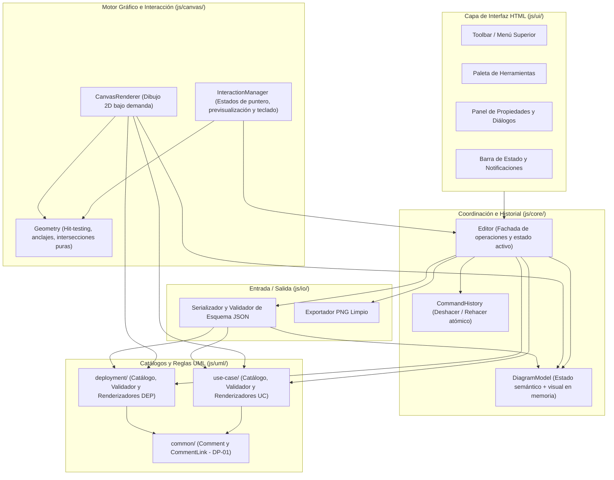

# Arquitectura Conceptual del Sistema (UML-00 / UML-00R)

> **Estado del documento:** Entregable reconciliado en **UML-00R**. Define la arquitectura conceptual, la separación entre modelo semántico y visual, el contrato del documento JSON versionado, las reglas de dependencia entre módulos y las decisiones técnicas con sus trade-offs, **sin implementar todavía código de la aplicación**.

---

## 1. Visión Arquitectónica y Principios de Diseño

El editor se diseña como una aplicación web modular ejecutada íntegramente en el navegador con **HTML5 semántico, CSS3, JavaScript Vanilla (ES Modules) y Canvas 2D**, estructurada en torno a **un motor gráfico compartido** y **dos catálogos UML independientes** (`use-case` y `deployment`), que comparten únicamente el descriptor de anotaciones comunes (`Comment` y `CommentLink`, aprobado en `DP-01`).

### Aplicación pragmática de principios (SOLID, KISS, DRY)

| Principio | Aplicación concreta en el proyecto | Trade-off asumido |
| --- | --- | --- |
| **S — Responsabilidad Única (SRP)** | Separación estricta en 8 subsistemas: modelo semántico, modelo visual, geometría pura, renderizador Canvas, gestor de interacciones, historial de comandos, validadores/catálogos UML y vistas DOM. | Mayor número de archivos pequeños frente a un archivo monolítico, compensado por una localización inmediata ante cambios en revisión académica. |
| **O — Abierto/Cerrado (OCP)** | Cada tipo de diagrama (`use-case`, `deployment`) registra un catálogo declarativo de tipos de elementos, tipos de relaciones, esquemas de propiedades, funciones de dibujo y reglas de validación. | Requiere definir un contrato uniforme de descriptor de tipo UML, pero evita condicionales `switch (element.type)` dispersos por el motor Canvas. |
| **L — Sustitución de Liskov (LSP)** | Todo descriptor de figura y todo validador de diagrama cumple el mismo contrato de entrada/salida (p. ej., cálculo de límites, punto de anclaje en el perímetro y resultado `{ isValid, errors, warnings }`). | Ningún elemento especial puede saltarse el flujo atómico del modelo. |
| **I — Segregación de Interfaces (ISP)** | Los módulos reciben únicamente los datos que necesitan: el validador recibe solo `model` (nunca `view` ni el DOM); la geometría recibe coordenadas numéricas puras; el renderizador lee `model`, `view` y el estado de selección sin mutarlos. | — |
| **D — Inversión de Dependencias (DIP)** | El núcleo del dominio (`DiagramModel`, `CommandHistory`, `UseCaseValidator`, `DeploymentValidator`, `Geometry`) **no importa ni depende de APIs del navegador (`window`, `document`, `HTMLCanvasElement`)**. | Permite ejecutar todas las pruebas unitarias y de integración del dominio directamente en Node.js sin necesidad de simular un navegador completo. |
| **KISS y DRY** | Se comparte la geometría común (intersección línea-rectángulo, línea-elipse, cálculo de flechas abiertas y triángulos huecos, pan/zoom) y las simplificaciones aprobadas (`DP-04` para instancias de despliegue y `manifestedElements` para `Manifestation`) sin crear un metamodelo MOF/XMI innecesario. | No se implementa el metamodelo completo de UML 2.5.1, sino exclusivamente el subconjunto normativo requerido por Casos de Uso y Despliegue. |

---

## 2. Diagrama de Capas y Reglas de Dependencia



### Reglas de dependencia obligatorias
1. **Unidireccionalidad de mutaciones:** Ni `CanvasRenderer` ni los componentes de `js/ui/` modifican jamás `DiagramModel` de forma directa. Toda modificación pasa por `Editor`, que valida la operación con el validador del diagrama activo y, si es válida, la registra en `CommandHistory`.
2. **Independencia del DOM en el dominio:** `js/core/DiagramModel.js`, `js/core/CommandHistory.js`, `js/canvas/Geometry.js` y las reglas en `js/uml/*/Validator.js` son módulos ES puros sin referencias a `document` ni `CanvasRenderingContext2D`.
3. **Aislamiento entre diagramas:** `js/uml/use-case/` no importa nada de `js/uml/deployment/` ni viceversa. Ambos consumen únicamente primitivas geométricas (`Geometry`) y la definición transversal de `Comment` / `CommentLink` (`DP-01`).

---

## 3. Estructura de Módulos Prevista y Responsabilidades

Siguiendo la guía de `GEMINI.md` (§4), los módulos se organizarán progresivamente conforme se autoricen los incrementos de código (**ninguno de estos archivos de código se crea en UML-00 ni en UML-00R**):

| Ruta prevista | Responsabilidad única (SRP) | Incremento de creación |
| --- | --- | --- |
| `index.html` | Estructura semántica HTML5 (`header`, `main`, `nav`, `aside`, `canvas`, controles accesibles y mensaje de respaldo). | UML-01 |
| `css/variables.css` | Tokens de diseño (`:root`): paleta de colores, tipografía, espaciados, bordes, sombras y radios. | UML-01 |
| `css/layout.css` | Distribución adaptable con CSS Grid y Flexbox para barra superior, paleta lateral, área central de Canvas, panel de propiedades y barra de estado. | UML-01 |
| `css/editor.css` | Estilos de componentes de UI, estados `:hover`, `:focus-visible`, `:disabled`, alertas y soporte `prefers-reduced-motion`. | UML-01 |
| `js/main.js` | Punto de entrada: inicializa `Editor` y conecta los adaptadores DOM/Canvas al cargar la página. | UML-01 |
| `js/core/Editor.js` | Coordinador central: administra el documento activo, el modo de diagrama, la selección, la herramienta activa y la ejecución validada de operaciones. | UML-01 |
| `js/core/DiagramModel.js` | Contenedor de datos del documento (`model` semántico y `view` visual), consultas por ID, gestión de `drawOrder` y garantías de integridad atómica. | UML-01 |
| `js/core/CommandHistory.js` | Pila de operaciones reversibles (`undo`/`redo`) con soporte para agrupar transacciones (arrastre, redimensionamiento o creación compuesta de `Extend` + `ExtensionPoint`) en un único paso. | UML-06 *(base en UML-02)* |
| `js/canvas/Geometry.js` | Funciones matemáticas puras: conversión de coordenadas pantalla ↔ mundo (zoom/pan), cajas delimitadoras, intersección de segmentos con elipses/rectángulos/cubos, cálculo de anclajes y distancia punto-segmento. | UML-01 / UML-02 / UML-03 |
| `js/canvas/CanvasRenderer.js` | Motor de dibujo 2D bajo demanda (`requestAnimationFrame`), ajuste de `devicePixelRatio`, transformación de cámara, delegación del dibujo de cada figura/relación al catálogo activo y capa opcional de selección/guías/previsualización. | UML-01 |
| `js/canvas/InteractionManager.js` | Máquina de estados de interacción (`PointerEvent` y teclado): selección, inserción, arrastre de elementos, redimensionamiento, trazado provisional de relaciones, pan/zoom y cancelación con `Esc`. | UML-02 / UML-03 |
| `js/uml/common/` | Descriptor, renderizador y regla de enlace para `Comment` y `CommentLink` reutilizables en ambos diagramas (`DP-01`). | UML-03 / UML-04 |
| `js/uml/use-case/` | Catálogo declarativo de Casos de Uso (`UseCaseCatalog.js`), validador normativo (`UseCaseValidator.js`) y funciones de dibujo en Canvas 2D (`UseCaseRenderers.js`). | UML-03 / UML-04 |
| `js/uml/deployment/` | Catálogo declarativo de Despliegue (`DeploymentCatalog.js`), validador normativo (`DeploymentValidator.js`) y funciones de dibujo en Canvas 2D (`DeploymentRenderers.js`). | UML-03 / UML-05 |
| `js/ui/` | Controladores de vista HTML (`ToolbarView.js`, `PaletteView.js`, `PropertiesPanel.js`, `StatusBarView.js`) que renderizan con `textContent` y delegan acciones a `Editor`. | UML-01 a UML-06 |
| `js/io/` | Serialización/importación con validación de esquema JSON (`JsonSerializer.js`, `SchemaValidator.js`) y exportación gráfica sin adornos de edición (`PngExporter.js`). | UML-06 |
| `tests/` | Suite de pruebas unitarias y de integración ejecutables con el runner nativo de Node.js (`node --test`). | UML-01 a UML-07 |

---

## 4. Modelo de Datos y Esquema de Documento JSON Versionado

Se adopta y detalla el esquema propuesto en `GEMINI.md` (§4), separando estrictamente la semántica UML (`model`) de la disposición gráfica (`view`):

```json
{
  "schemaVersion": 1,
  "id": "doc-8f92a1",
  "name": "Sistema de Banca en Línea",
  "diagramType": "use-case",
  "model": {
    "elements": [
      {
        "id": "sb-1",
        "type": "SystemBoundary",
        "name": "Portal Bancario",
        "parentId": null,
        "properties": {
          "stereotype": ""
        }
      },
      {
        "id": "act-1",
        "type": "Actor",
        "name": "Cliente",
        "parentId": null,
        "properties": {
          "isAbstract": false,
          "notationVariant": "stickman"
        }
      },
      {
        "id": "uc-1",
        "type": "UseCase",
        "name": "Transferir Fondos",
        "parentId": "sb-1",
        "properties": {
          "isAbstract": false,
          "showExtensionPoints": true,
          "extensionPoints": [
            { "id": "ep-1", "name": "Monto Mayor al Límite" }
          ]
        }
      },
      {
        "id": "cmn-1",
        "type": "Comment",
        "name": "",
        "parentId": null,
        "properties": {
          "body": "Operación disponible 24/7 vía SPEI"
        }
      }
    ],
    "relationships": [
      {
        "id": "rel-1",
        "type": "Association",
        "sourceId": "act-1",
        "targetId": "uc-1",
        "name": "",
        "properties": {
          "sourceMultiplicity": "1",
          "targetMultiplicity": "0..*",
          "sourceRole": "",
          "targetRole": ""
        }
      },
      {
        "id": "rel-2",
        "type": "CommentLink",
        "sourceId": "cmn-1",
        "targetId": "uc-1",
        "name": "",
        "properties": {}
      }
    ]
  },
  "view": {
    "elements": {
      "sb-1": { "x": 240, "y": 80, "width": 420, "height": 320 },
      "act-1": { "x": 80, "y": 180, "width": 60, "height": 90 },
      "uc-1": { "x": 340, "y": 160, "width": 180, "height": 80 },
      "cmn-1": { "x": 340, "y": 280, "width": 180, "height": 60 }
    },
    "relationships": {
      "rel-1": { "waypoints": [] },
      "rel-2": { "waypoints": [] }
    },
    "drawOrder": ["sb-1", "uc-1", "act-1", "cmn-1"]
  }
}
```

> **Propiedades específicas en modo `deployment` (`DP-04` y `DEP-REL-03`):** En documentos con `diagramType: "deployment"`, los elementos `Node`, `Device`, `ExecutionEnvironment` y `Artifact` admiten en `properties` los campos `{ isInstance: boolean, classifierName: string }` (`DP-04`). Además, `Artifact` admite `manifestedElements: Array<{ name: string, kind: "Component" | "Package" | "Class" | "Interface" | "Classifier" }>` para representar elementos empaquetables manifestados que no tienen herramienta propia en el lienzo de despliegue.

### Invariantes obligatorios del modelo de documento

1. **Identificadores únicos y estables en todo el documento:** Cada elemento en `model.elements` y cada relación en `model.relationships` posee un `id` string único global dentro del documento (el espacio de IDs es disjunto entre `elements` y `relationships`, lo que permite resolver de forma inequívoca cualquier referencia polimórfica como `CommentLink`).
2. **Correspondencia 1 a 1 entre `model` y `view`:**
   - Todo `element.id` presente en `model.elements` debe tener una entrada `{ x, y, width, height }` numérica finita (`width > 0`, `height > 0`) en `view.elements[id]` y figurar exactamente una vez en `view.drawOrder`.
   - Todo `relationship.id` presente en `model.relationships` debe tener una entrada `{ waypoints: Array<{ x, y }> }` en `view.relationships[id]`.
3. **Relaciones basadas en IDs, nunca en coordenadas sueltas, y contrato de `CommentLink`:**
   - En toda relación UML semántica (`Association`, `Include`, `Extend`, `Generalization`, `CommunicationPath`, `Deployment`, `Manifestation`, `Dependency`), tanto `sourceId` como `targetId` deben referenciar IDs existentes en `model.elements` (`sourceId !== targetId`).
   - En `CommentLink` (`Comment::annotatedElement : Element[*]`, donde `Relationship` es subtipo de `Element` según OMG UML 2.5.1 `§7.2.2`), `sourceId` debe referenciar un elemento de tipo `"Comment"` en `model.elements`, mientras que `targetId` (`targetId !== sourceId`) puede referenciar **bien un elemento en `model.elements`, bien una relación semántica en `model.relationships`** (excluyendo otro `CommentLink` para evitar cadenas recursivas de anclaje).
   - Los puntos de conexión finales se calculan dinámicamente en `Geometry` a partir de las cajas actuales de `view.elements` (o del punto medio de la polilínea de la relación destino cuando un `CommentLink` anota una relación). Al eliminar un elemento o una relación, cualquier relación o `CommentLink` incidente se elimina en cascada dentro de la misma operación atómica.
4. **Separación entre contención semántica (`parentId`) y posición visual (`x, y`):**
   - La pertenencia UML reside exclusivamente en `element.parentId` dentro de `model.elements`.
   - Superponer visualmente dos elementos sin ejecutar una operación de contención válida no modifica `parentId`.
   - Cuando un elemento tiene `parentId !== null`, el orden de dibujo (`drawOrder`) garantiza que el contenedor padre se dibuje antes (debajo) que sus hijos semánticos, de modo que los hijos nunca queden ocultos detrás del relleno del padre.
5. **Coordenadas independientes de la cámara:** `view.elements[id]` almacena siempre coordenadas lógicas del mundo del diagrama. El estado de navegación (`zoom`, `panX`, `panY`) pertenece a la sesión visual del `Viewport` y no contamina las coordenadas guardadas de los elementos (`GEMINI.md` §7 y §9).

---

## 5. Contratos Conceptuales Clave

### 5.1 Contrato de Registro de Diagrama (Abierto/Cerrado)

Cada modo (`use-case` y `deployment`) expondrá un objeto descriptor de catálogo con la siguiente estructura conceptual:

- `diagramType`: `"use-case"` | `"deployment"`
- `elements`: mapa de definiciones de elementos (`type`, etiqueta de UI, tamaño por defecto, tamaño mínimo, si es contenedor, propiedades por defecto, esquema de campos editables para el panel de propiedades, función de hit-testing específico y función de renderizado Canvas).
- `relationships`: mapa de definiciones de relaciones (`type`, etiqueta de UI, estilo de línea continua/discontinua, tipo de punta de flecha en origen/destino, etiqueta fija como `«include»`/`«extend»`/`«deploy»`/`«manifest»`, y esquema de campos editables).
- `validator`: objeto validador con métodos puros:
  - `validateElementContainment(model, childType, parentId)` → `{ isValid, errors, warnings }`
  - `validateRelationship(model, relType, sourceId, targetId, properties)` → `{ isValid, errors, warnings }`
  - `validateDocument(documentData)` → `{ isValid, errors, warnings }`

### 5.2 Contrato de Operaciones Atómicas, Previsualización e Historial

Toda acción del usuario que modifique el documento se expresa como un comando reversible o transición atómica:
1. **Pre-validación:** Antes de mutar `DiagramModel`, se consulta al validador correspondiente. Si devuelve `isValid: false`, se aborta la operación sin modificar `model` ni `view` y se emite una notificación de error estructural a la UI.
2. **Confirmación diferida y atómica en relaciones que requieren metadatos obligatorios (`Extend` — `DP-03`):**
   - Durante el trazado de una relación, `InteractionManager` mantiene un estado efímero de previsualización (`provisionalConnection`) dibujado en la capa de overlays de `CanvasRenderer` sin tocar `DiagramModel`.
   - Cuando el tipo de relación es `Extend` y el par `(sourceId, targetId)` es estructuralmente válido (`UseCase → UseCase` distintos), el flujo solicita asignar un `ExtensionPoint` existente en `targetId` o crear uno nuevo con nombre no vacío.
   - Si el usuario cancela (`Esc` o cierre del diálogo), `provisionalConnection` se descarta sin mutar `DiagramModel`. Si confirma, se ejecuta **un único comando atómico** que (a) registra el nuevo `ExtensionPoint` en `targetId` (si fue creado en ese paso) y (b) inserta la relación `Extend` con su `extensionLocation` válido.
3. **Transacción de interacción continua (arrastre / redimensionamiento):**
   - En `pointerdown`, se captura una instantánea de las posiciones/dimensiones iniciales de los elementos afectados.
   - Durante `pointermove`, se actualiza la vista provisionalmente para dar retroalimentación fluida a 60 fps.
   - Si el usuario pulsa `Esc` o se dispara `pointercancel`, se restauran las posiciones iniciales y no se registra ningún comando.
   - En `pointerup`, si hubo desplazamiento real, se consolida como **un único comando** en `CommandHistory` (`GEMINI.md` §9).
4. **Exportación PNG aislada del estado de edición:** `PngExporter` invoca a `CanvasRenderer` sobre un lienzo temporal (o contexto limpio) pasando la opción `{ includeEditorOverlays: false }`, lo que omite bordes de selección, manejadores de redimensionamiento, rejilla y enlaces provisionales.

---

## 6. Guía Arquitectónica de Localización de Cambios

Para satisfacer `RNF-01` y facilitar ajustes rápidos durante las revisiones académicas del profesor, cada categoría de cambio tiene un único punto de modificación:

| Cambio posible en revisión académica | Ubicación exacta donde se realizará | Impacto en otros módulos |
| --- | --- | --- |
| Cambiar paleta de colores, fuentes o tamaños de paneles | `css/variables.css` y `css/layout.css` | Ninguno en JavaScript ni en el modelo. |
| Cambiar el dibujo del `Actor`, `UseCase`, `Node`, `Artifact` o `Comment` | Función del tipo en `js/uml/use-case/UseCaseRenderers.js`, `js/uml/deployment/DeploymentRenderers.js` o `js/uml/common/` | Ninguno en `CanvasRenderer`, `InteractionManager` ni `DiagramModel`. |
| Permitir o restringir una relación o contención entre dos elementos | Matriz/regla en `js/uml/use-case/UseCaseValidator.js` o `js/uml/deployment/DeploymentValidator.js` | Ninguno en el motor de interacciones ni de renderizado. |
| Añadir un nuevo atributo editable a un elemento o relación | Esquema de propiedades en `UseCaseCatalog.js` / `DeploymentCatalog.js` | `PropertiesPanel.js` genera los controles HTML a partir del esquema declarativo sin reescribir la UI. |
| Ajustar la tolerancia al clic en líneas o el cálculo de anclajes | `js/canvas/Geometry.js` | Verificable inmediatamente mediante pruebas unitarias en Node.js. |
| Cambiar el formato de nombre del archivo JSON o validaciones al abrir | `js/io/JsonSerializer.js` y `js/io/SchemaValidator.js` | Ninguno en el motor Canvas. |
